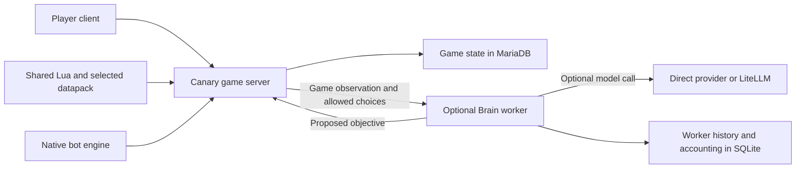

# Canary server documentation · consolidated EGM review

Fix the WSL install and shutdown guides before using them on a saved world.
The desktop asset instructions also need a compatible protocol-1500 client
recipe. The current M5 runner cannot satisfy the documented 10-second
supervised completion check. Elsewhere, the main gaps are in navigation, the
scope of historical evidence and acceptance for the proposed player guides.

Reviewed the working copy of `canary-bots-with-cast` based on
`ecc74f0392f05565140d1009d6990ef1d294f94b`. The inventory includes **663 Markdown
files and 37,821 lines**, including visible work in progress. Independent
reviewers read the entry guides, design and readiness documents, and samples of
module and content contracts against source. Automated checks covered every
Markdown file. The report describes the source and the evidence in the
checkout. It makes no claim about which build or provider is active on a live
deployment. The inventory records the review-time snapshot, including two
local drafts. Code line links point into the repository layout reviewed here.

## Prioritized findings

### Blockers for the documented workflows

**B1 · The WSL fresh-install recipe leaves required mounts unresolved.** The
setup script creates database seed files and JSON configurations in the new
checkout. Compose renders the game config, Lua template, map and worker inputs
under the reference site's fixed Linux path. The image ships a Lua template,
but the mount replaces it and the entrypoint reads it immediately. A clean
checkout can pass `docker compose config --quiet` while lacking the files the
container will read. Use the selected runtime root throughout and move the
reference-site template to an explicit override, or document the full set of
required files as a prerequisite for this recipe. Acceptance is a fresh
disposable installation from a different home directory with the expected
file types checked before starting. [Setup](../../../deployment/brain/SETUP.pt-BR.md#L20) ·
[Compose mounts](../../../deployment/wsl/compose.yaml#L131) ·
[Setup script](../../../deployment/wsl/setup.py#L8) ·
[Template read](../../../deployment/wsl/game-entrypoint.py#L53) ·
[Rendered bind paths](compose_bind_check.json) · [Fresh setup result](fresh_setup_check.json)

**B2 · The desktop recipe mixes client protocol and asset layouts.** It asks
for `Tibia.dat` and `Tibia.spr` under `data/things/1100/` while selecting
protocol 1500. The server pins 1500, browser and replay staging expect
`data/things/1500/`, and the local OTClient loader at `730e12617` uses
appearances and static data under the protocol directory in modern mode. Pin
the tested desktop build and asset layout, then verify a clean login and cast
session. Keep any legacy procedure version-scoped. [Desktop guide](../../../deployment/client/README.md#L11) ·
[Server protocol](../../../src/core.hpp#L18) ·
Desktop loader (sibling checkout: `tibia-otclient/modules/game_things/things.lua:44`, `730e12617`) ·
[Browser packager](../../../deployment/browser/package_client.py#L199)

**B3 · The setup guide's stop command conflicts with save recovery.** The
quick command stops the entire stack with a timeout. The WSL runbook keeps
MariaDB available until the game confirms the save and exits. If a save fails,
the game keeps a checkpoint in the original process for a retry. A forced
stop can remove that recovery path. Make the detailed WSL procedure the
canonical shutdown path and identify all active optional profiles, including
the dedicated Gemini Decisions service. [Setup shutdown step](../../../deployment/brain/SETUP.pt-BR.md#L632) ·
[Save-aware shutdown](../../../deployment/wsl/README.md#L316) ·
[Checkpoint recovery](../../../src/game/game.cpp#L8635)

**B4 · The M5 handbook advertises inputs its current supervised driver
cannot qualify.** The 10-second recipe uses a campaign runner that always
enables native supervision. Native completion requires at least 1,800 seconds.
The handbook also describes separate app and native source identities.
The driver records the frozen native SHA but passes the app revision as the
runner's native admission pin. With different revisions, the server's
attestation and the worker pin cannot match. Give the short smoke its own
bring-up result, or document its expected early stop. Pass a separate verified
native revision to the worker if two-revision runs are supported. Preserve the
strict source checks. [M5 handbook](../../../tests/fixture/M5_CURRENT_QA.md#L18) ·
[Driver](../../../tests/fixture/m5_current_qualification.py#L733) ·
[Worker config](../../../deployment/brain/src/canary_brain/benchmark.py#L808) ·
[Minimum supervised window](../../../deployment/brain/src/canary_brain/benchmark_stops.py#L160)

**B5 · B1's database commands lack the authentication its profile requires.**
The leader and slice examples, and the generated ready-check command, call
`mariadb -ucanary` without supplying a password. The Compose profile requires
one when it provisions that account. Reuse the existing Stage 1 method of
reading the environment within the database container. Verify leader setup and
read-only slices against a fresh disposable B1 instance. [B1 commands](../../../deployment/core-qa/B1_FIXTURE.md#L194) ·
[Generated command](../../../deployment/core-qa/b1_fixture.py#L758) ·
[Database profile](../../../deployment/core-qa/compose.yaml#L10) ·
[Existing authentication pattern](../../../deployment/core-qa/stage1_baseline.py#L230)

### Major

| ID | What the reader could get wrong | Proposed documentation or design change |
| --- | --- | --- |
| M1 | The entry pages list directories and emphasize the fork's bots. Players still need to find core systems such as Prey, Wheel and Bosstiary, and operators need to choose among deployment paths with different login and feature support. | Link the feature guide from the root. Explain shared Lua, one selected datapack, maps and migrations. Put a deployment selector in the existing deployment index. [Root](../../../README.md#L490) · [Deployment index](../../../deployment/README.md#L4) · [Loader](../../../src/canary_server.cpp#L378) |
| M2 | Old deployment notes still describe 35-second pauses after each group of 50 bots. Dated Brain evidence uses present-tense claims about native XP and production. M5's original, current-native/fake, and prospective supervised instructions sit beside each other. | Give each report its environment, revision and evidence scope. Point daily operators to the current startup and XP guides. Identify the intended M5 entry for each kind of run and keep the timed, supply, persistence and paid gates visible as separate requirements. [Deployment notes](../../../deployment/DEPLOYMENT_STATUS.md#L46) · [Startup code](../../../data/scripts/globalevents/bot_manager.lua#L417) · [Brain evaluation](../../../deployment/brain/EVALUATION.md#L47) · [Fixture index](../../../tests/fixture/README.md#L11) |
| M3 | Party docs imply a bot always walks in and can be selected by `/party` alone for Brain tests. Source permits staging and teleport fallback. The QA playbook calls for finding the named pilot and inviting it in the client. | Explain both recruitment paths and name the prerequisites. Clarify that the Casual preset disables gang raids and that human targeting is separately configured. [Player commands](../../../README.md#L310) · [Assembly fallback](../../../src/creatures/players/bot/bot_party.cpp#L639) · [QA recruitment](../../../deployment/core-qa/ROTEIRO.md#L17) · [Preset](../../../config.lua.dist#L1508) |
| M4 | The world map promises all online characters and live positions. The stock map polls saved positions for the bot account. Changing the filter changes whose positions the web page presents. A separate monitoring command writes status requests despite being easy to read as a passive check. | Document the map's filter, freshness and exposure at the configuration entry. Put the monitor's queue and history writes beside its command, with the ops digest linked for passive health checks. [Map settings](../../../deployment/web/plugins/worldmap/config.php#L12) · [Map query](../../../deployment/web/plugins/worldmap/pages/worldmap.php#L30) · [Monitor](../../../deployment/wsl/monitor-bot.py#L24) |
| M5 | General `/guia` advice, the native Thais escort proposal and current `/brain` can look like one feature. Some present-tense text implies the escort branch exists. The early brief describes the wrong dispatcher. | Point from the brief to both proposals and mark their status. Keep the current Brain contract clear. Define the two QA fixtures. Decide how the escort handles a pending invite on reconnect and how read-only chat handles late answers to a changed session. [Brief](../../../concepts_brief.md#L26) · Thais (review-time local draft: `design_draft.md:24`) · [Chat proposal](../../../deployment/brain/GUIA_DO_JOGADOR.md#L21) |
| M6 | The research draft can be read in this workspace, but ten links point outside a standalone clone. The quest pilot permits model judgments that could agree on different clues. The media pilot changes the kind of input and provider without a matching record and cost contract. | Publish shareable, revision-bound evidence. Use one identified clue that the server can check against the discovered, authored set. Declare what data the media pilot may send, retain and charge for each arm. Proposal and evidence (review-time local draft: `deployment/brain/EXPERIMENTOS_SYSTEM_ONE.pt-BR.md:7`) · Pilot criteria (review-time local draft: `deployment/brain/EXPERIMENTOS_SYSTEM_ONE.pt-BR.md:70`) · [Runner accounting](../../../deployment/brain/tools/jev_experiments.py#L404) |
| M7 | A generic verification link can look like feature coverage. For example, the Canary quest README states no side effects, while its scripts grant rewards and change world and player state. The linked Lua checks exercise startup and save. | Audit documented effects and choose an actual local verification target per subsystem when one exists. Keep the central test guide as a navigation aid. [Quest docs](../../../data-canary/scripts/actions/quests/README.md#L10) · [Reward code](../../../data-canary/scripts/actions/quests/quests.lua#L19) · [Lua tests](../../../tests/lua/README.md#L17) |
| M8 | The replay guide describes the first eligible delivery status as sufficient for a supervised completion. The worker expects a native admission baseline, a terminal fence with the matching request nonce, and durable proof after recorder close. | Link the supervised harness contract for the current protocol. Preserve legacy evidence as dated. Make the shorter replay viewing path independent of campaign admission. [Replay guide](../../../deployment/brain/REPLAY.md#L69) · [Fence contract](../../design/native-supervised-harness-interface.md#L109) · [Worker fence](../../../deployment/brain/src/canary_brain/supervised_native.py#L237) |
| M9 | The short WSL rebuild block omits `SOURCE_REVISION`, which defaults to a value the game build rejects. Switching the worker example from Responses to Luna Decisions alone also fails validation because the existing price has billable output. | Point the rebuild block to the existing source verification step. Provide a complete matching model, endpoint, pricing and configuration example. Preserve the validation that rejects an unbounded charge. [Build command](../../../deployment/wsl/README.md#L302) · [Build verifier](../../../deployment/wsl/verify-build-source.py#L12) · [Luna route instructions](../../../deployment/wsl/README.md#L258) · [Local validator result](gateway_config_check.txt) |
| M10 | The desktop example uses the default port 80 while the WSL HTTP login is on 8080. Browser deployment needs the HTTPS adapter and WSS route. The visual replay guide gives capture variables but the base QA service does not pass them or mount the capture output. | Name the endpoints by deployment. Add a browser acceptance check for headers, assets, login adapter and world connection. Provide an isolated visual QA override with writable capture output and matching worker telemetry for the same GUID. [Desktop entry](../../../deployment/client/README.md#L31) · [WSL endpoints](../../../deployment/wsl/README.md#L59) · [Browser setup](../../../deployment/browser/README.md#L21) · [Capture](../../../deployment/brain/REPLAY_VISUAL.pt-BR.md#L17) |

### Minor

- Give generated entry pages a concrete responsibility and link to the next likely question. The scan found 85 generic package descriptions and 111 explicit empty invariant sections. Test any replacement against a few high-traffic modules before regenerating the tree.
- Either date fixed counts and performance statements or give a reproducible source. A local CSV scan found 263 hunt rows and 260 enabled, with 17 enabled rows marked `is_quest`. The root still says 258 enabled. The SQL has 48 `CREATE TABLE` statements and the root says 42.
- Link the native-admission variables and earlier fixture names at first use. Keep the existing definitions in the harness contract.

## Deployment choices

| Path | What it gives you | First step |
| --- | --- | --- |
| Local Linux build | Compile Canary and its matching bot library. Prepare the database, map and compatible client. | [Quick start](../../../README.md#L204) |
| Generic Compose | MariaDB, game and the OpenTibiaBR login service. MyAAC-specific cast pages are documented in a separate path. | [Docker guide](../../../docker/DOCKER.md) |
| WSL reference stack | MariaDB, game, MyAAC and cast, with optional Brain and LiteLLM profiles. The fresh-install mounts need the B1 correction. | [WSL guide](../../../deployment/wsl/README.md) |
| Core QA and B1 | Isolated services, identities and evidence. Base QA has Brain off, with separate fake-worker and companion-fixture workflows. | [Core QA](../../../deployment/core-qa/README.md) |
| ARM64 host | The example uses an emulated AMD64 binary pair. A separate WSL recipe covers building ARM64 release artifacts. | [Compatibility](../../../deployment/INSTALLATION_COMPATIBILITY.md#L22) |
| Browser play | Packages a compatible OTClient WebAssembly build, separate modern assets, MyAAC login and a WSS adapter. | [Browser deployment](../../../deployment/browser/README.md) |

## Server feature guide

Feature names below describe the capabilities present in the source. A selected
datapack, compatible clients, account permissions, runtime configuration and
installed services determine what a particular player can use. The feature
inventory is grouped by system. The individual quests, NPCs, monsters, spells
and item actions are indexed by their own directories in the corpus inventory.

The following diagram shows who can change the game. It applies to a server
configured with Brain. A native-only server runs the game and native bots on
the left-hand side without the optional model path.

### The game server

| Feature family | What it does | Source entry point |
| --- | --- | --- |
| Startup and configuration | Reads Lua configuration, connects to MariaDB, updates the schema, loads shared scripts and one selected datapack, then loads the map and starts the game listeners. The default datapack is `data-otservbr-global`. `data-canary` is another content set. | `src/canary_server.cpp`, `config.lua.dist`, `src/database/databasemanager.cpp` |
| Accounts, login and sessions | Authenticates a player and loads a character into the game. Clients use the game protocol and can use a compatible HTTP login. The current game protocol constant is 1500. Permission groups govern administrative commands. A native status listener reports world status. | `src/account/`, `src/core.hpp`, `src/server/network/protocol/`, `data/XML/groups.xml` |
| World, zones and movement | Holds the tile map, creatures, floors, houses and zones. Movement rules cover tile access, speed, stairs, teleports and other floor changes. Lua actions and movement callbacks add rules for particular tiles and objects. | `src/map/`, `src/game/movement/`, `src/game/zones/`, `data/scripts/movements/` |
| Datapacks, events and schedules | Lua registers creature types, actions, movements, spells, callbacks, global events and commands. Scheduled events, raids and world changes can spawn enemies, change access or adjust the state of a region. | `src/lua/`, `data/scripts/`, `data-otservbr-global/{scripts,raids,startup}/` |
| Monsters, NPCs and quests | A monster type defines combat behavior, abilities and loot. NPC scripts handle dialogue, shops, travel and quest progression. Quest rooms, doors, objectives and rewards are driven by the selected datapack and player storage. | `src/creatures/{monsters,npcs}/`, `data-otservbr-global/{monster,npc,scripts/quests}/` |
| Character progression | Experience raises level and applies vocation gains. Skills, magic level, stamina and configurable rate stages affect progression. Vocation, promotion and equipment rules govern access and stats. | `src/creatures/players/player.cpp`, `src/creatures/players/vocations/`, `data/stages.lua` |
| Combat, spells and PvP | Resolves weapon attacks, healing, spells, runes, summons, conditions, death and protection rules. The world configuration and tile or zone rules determine where player combat is allowed. Death penalties, blessings and protection are part of character state and rules. | `src/creatures/combat/`, `src/items/weapons/`, `data/scripts/{spells,runes}/`, `config.lua.dist` |
| Party, guild and communication | Handles invites, joining, leadership, shared experience, guild membership and communication channels. Player chat, whispers and private messages use the game's chat layer. | `src/creatures/players/grouping/`, `src/creatures/interactions/chat.cpp`, `data/chatchannels/` |
| Inventory, containers and storage | Handles equipment, bags, loot, items that decay, depots, inboxes, mail and reward chests. Auto-loot and player or quest storage have their own handlers and persistence. | `src/items/`, `src/creatures/players/components/player_storage.cpp`, `data/scripts/talkactions/player/auto_loot.lua` |
| Equipment customization | Imbuements attach timed effects to supported equipment. Forge and item-tier flows handle upgrades and history. The Wheel of Destiny assigns progression points and handles gem or ability effects. | `src/creatures/players/imbuements/`, `src/creatures/players/components/wheel/`, `data/scripts/systems/item_tiers.lua` |
| Collections and hunt systems | Bestiary and Bosstiary track kills. Charms grant effects tied to monsters. Prey and Task Hunting have their own slots and rewards. Cyclopedia exposes character and collection information. Animus Mastery stores its own progress and applies configured bonuses. | `src/io/iobestiary.cpp`, `src/io/ioprey.cpp`, `src/creatures/players/animus_mastery/`, `src/server/network/protocol/protocolgame.cpp` |
| Bank, shops, market and store | In-game gold supports banking, NPC purchases and player market orders. The built-in store and daily reward modules expose configured offers and rewards. World rules and account or character state constrain actions. | `src/game/bank/`, `src/io/iomarket.cpp`, `data/modules/scripts/{gamestore,daily_reward}/` |
| Houses, outfits and mounts | Players can acquire and decorate houses, manage access and interact with hirelings. Outfits, mounts and effects change the character's presentation. Native bots participate in housing through separate rules. | `src/map/house/`, `src/creatures/appearance/`, `data/modules/scripts/hirelings/` |
| Saves and administration | SQL stores characters, items, quest state, accounts and world data. The Key-Value store and PlayerStorage support game state. Dispatcher jobs schedule mutations. Server saves, migrations, backup, logs, metrics and permission-gated commands support operations. | `src/{database,io,kv}/`, `src/game/scheduling/`, `data/scripts/{globalevents,talkactions}/` |

### Native bots

| Feature family | What it does | Source entry point |
| --- | --- | --- |
| Population and startup | Seeds give the world 997 candidate bot characters. Settings control how many load and whether they are published as online. Startup loads one at a time and stretches the delay when work is slow. It publishes progress in groups of 50. | `database/bots/`, `data/scripts/globalevents/bot_manager.lua` |
| Daily activity and hibernation | Native rules weigh travel, idle time, hunts, points of interest and parties. Nearby players, caps and viewer presence influence what runs. Hibernation removes active world presence and preserves enough state for wake-up. The simulator advances supported activity while active combat and XP use normal game events. | `src/creatures/players/bot/{bot_tick,bot_liveness,bot_engine,bot_roam}.cpp` |
| Travel and route choice | The bot follows authored CSV routes, finds paths on the current floor, and uses transitions such as stairs, ropes, ladders and doors. Nearby roaming and route variations reduce repeated paths. | `data/bot/authored/`, `src/creatures/players/bot/{bot_nav,bot_zgraph,bot_waypoint,bot_travel}.cpp` |
| Hunt, loot and resupply | A hunt can travel to a spawn, patrol, fight, take loot, return and buy supplies. The native engine chooses admissible hunts, targets and combat tactics. It also handles luring, keeping distance, retreat, food, potions, runes and fishing where configured. | `src/creatures/players/bot/{bot_hunt,bot_combat,bot_supply}.cpp` |
| XP and lifecycle persistence | Kills can earn normal XP and level gains. The bot can survive a save, hibernation or engine reload with its progressed state, subject to successful checkpoints and the documented failure paths. Native SQL checkpoints and Brain learning use separate stores. | `src/creatures/players/bot/bot_engine.cpp`, `src/io/functions/iologindata_save_player.cpp`, `tests/lua/README.bot-progression.md` |
| Parties, self-defense and PvP | Bots can accept invites, walk to a rally point, follow a leader across floors, and coordinate combat. Users can summon or dismiss helpers with `/party`. Assembly can use off-screen staging or fall back to teleport. Bot-led parties and PvP behavior have independent limits. The trailing Casual preset disables gang raids. `/cavebot claim` reserves a hunt for a human player. | `src/creatures/players/bot/{bot_party,bot_combat,bot_command}.cpp`, `data/scripts/talkactions/player/bot_party.lua` |
| Social simulation and economy | Templates generate local banter, private messages and trade ads. Market sweeps submit or fill orders under price and depth controls. Bots own, furnish and use houses. A player can claim, sub-own or release a bot house through `/house`. | `src/creatures/players/bot/{bot_chat,bot_house}.cpp`, `data/scripts/globalevents/bot_market.lua`, `data/scripts/talkactions/player/bot_house.lua` |
| Cast and live observation | Human characters can activate a broadcast with `/cast on`. A cast-compatible login lists active bot and human broadcasts for `@cast`. Selecting a sleeping bot can wake it, so a cast session can affect a benchmark. | `src/creatures/players/cast/`, `data/scripts/talkactions/player/cast.lua`, `deployment/web/login.php` |
| Operations and hot reload | The separate C++ bot engine can reload with a matching ABI and exported handoff contract. Operators have diagnostics, traces and native status. Changing the server-side ABI or other compiled server behavior can require a matching server and library build. | `src/creatures/players/bot/bot_engine_loader.cpp`, `tools/bot_brain/README.reload.md` |

### Brain, replay, web and operations

| Feature family | What it does | Source entry point |
| --- | --- | --- |
| Optional AI companion | The server sends a bounded observation and offered actions to a separate Python worker. The worker can select a candidate or interpret a request. The server checks the intent against live state and performs it through its own gameplay systems. Native movement, combat, emergency healing and safety continue locally. | `src/creatures/players/bot/bot_brain.cpp`, `deployment/brain/src/canary_brain/{runtime,controller}.py` |
| Human-led companion and solo explorer | `/brain` opens the channel to a configured companion. A human party leader can set objectives. The configured solo explorer can accept an objective outside a human party, otherwise select hunts, resupply or retreat under its rules. The worker can skip a recently failed safe retreat route for a bounded time and exclude poor-performing hunts temporarily. | `data/scripts/talkactions/player/brain.lua`, `deployment/brain/README.md`, `deployment/brain/src/canary_brain/supervision.py` |
| Providers and accounting | Native mode can observe gameplay without inference. The explicit fake provider supports offline fixtures. Direct OpenAI and configured LiteLLM routes provide model calls. The dedicated Gemini Decision 1 service is a configurable route. A split Responses route can handle chat or planning when Decisions selects actions. The worker accounts for requests against configured limits. | `deployment/brain/src/canary_brain/{runtime,gateway,provider,store}.py`, `deployment/wsl/compose.yaml` |
| Learning and supervision | A verified terminal hunt outcome contributes to a contextual preference for eligible hunts. Context includes character and world conditions. Evidence, rewards and reflection have different meanings. Learning affects later choices through the local SQLite state and does not train the model. | `deployment/brain/src/canary_brain/{controller,learning,supervision,store}.py` |
| Replay and visual replay | Structured replay records lifecycle, telemetry, decisions and outcomes for review, export and comparison. Visual replay captures a different stream of server packets for playback with matching client assets. The two paths have different coverage and prerequisites. | `deployment/brain/REPLAY.md`, `deployment/brain/REPLAY_VISUAL.pt-BR.md`, `deployment/brain/src/canary_brain/{recording,replay,visual_replay}.py` |
| Web login, map and browser client | MyAAC can serve cast-aware HTTP login and a map of persisted positions. The stock map filter selects bot account 65000. The browser deployment packages a compatible OTClient WebAssembly build and uses a WSS gateway to the game listener. The Voxel Explorer is a separate web visualization of Thais. | `deployment/web/`, `deployment/browser/README.md`, `deployment/web/voxel-explorer/README.md` |
| Deployment, monitoring and QA | The bare-metal path, general Docker path, reference WSL stack and isolated Core QA path support different combinations of the above. The ops digest reads health and status. The monitor can issue a bot status command. Qualification, benchmark and replay tools establish evidence under controlled inputs. | `docker/DOCKER.md`, `deployment/wsl/{README.md,ops-digest.py,monitor-bot.py}`, `deployment/core-qa/README.md` |
| Research and planned player guides | Jev tools run decision experiments against synthetic and optionally paid inputs. The repo also contains proposed general advice through `/guia` and a separate in-world Thais tour through `/party guia`. The current companion command is `/brain`. | `deployment/brain/tools/README.md`, `deployment/brain/GUIA_DO_JOGADOR.md`, `design_draft.md`, `data/scripts/talkactions/player/brain.lua` |

## Feature specifications and implementation readiness

The existing player-facing AI command is `/brain`. The two guide proposals
describe distinct experiences. General `/guia` answers questions without
issuing orders. `/party guia` is a native walk behind a dedicated bot. Neither
proposal should inherit the other's acceptance criteria.

| Plan or workflow | What the source already supports | Readiness verdict |
| --- | --- | --- |
| Fresh deployment and shutdown | Setup scripts, Compose profiles, native build verification, and a save-aware shutdown runbook. | **Blocked as written** by B1/B3. Choose the intended mounts and canonical stop procedure. Scope examples to the deployment and source identity. |
| Desktop and browser clients | Server protocol 1500, cast-aware MyAAC login and a version-specific WASM packager. | **Desktop guide blocked as written** by B2. Browser packaging can be exercised with its specified inputs. A live browser acceptance needs the actual HTTPS login and WSS connection. |
| Thais temple-to-depot escort | Seven authored points, native walking primitives and party APIs. | **Design needs decisions.** Bind one movement owner, validate steps when executed, define pending invites and reconnect precedence, and provide an isolated fixture. Verify the route with the map loaded. |
| Read-only `/guia` | Native spell rules, a player API for registered castable spells, and existing read-only Brain console tests. | **Proposed.** First exercise a local `exura` response with deterministic data. A model-backed solo flow still needs an authenticated request path, action-free tools, bounded requests and private, session-bound delivery. |
| Jev and System One pilots | Synthetic hunt and action fixtures, claim checks and clip ranking. Replay provides time alignment and chapter navigation. | **Ready for existing synthetic checks.** The proposed play-style, detective and replay-search comparisons need their baseline, shared inputs, holdout and failure rules. Those results cannot establish a gameplay promotion. |
| Native timed qualification | Native admission and a matching terminal fence exist in the source and pass controlled tests. | **Runbook and driver gaps.** Resolve B4 and M8. A qualifying run needs its own verified build, transport, observed window, completion proof and persistence evidence. |
| Persistence witness | An opt-in adapter and tests exercise Lua, SQLite and rejection paths. | **Activation still requires proof.** Verify that a new owned run wires the adapter and closes callbacks and queues around the save. Confirm the embedded runtime and final evidence for that build. |
| Core QA B1 companion fixture | SQL, overlays, stage checks and offline tests exist. | **Runbook blocked on authenticated SQL.** Complete B5 and demonstrate the fixture against a disposable database before reporting a live pass. |
| Structured and visual replay | Structured recording/export and packet capture/pack/stage/video commands exist. Admission and visual replay focused tests passed. | **Offline components available.** Visual capture in QA still needs a named overlay, paired telemetry and a runtime acceptance. Whole-life chapters require separate evidence. |
| Paid M5 | Source-bound preflight, claim checks, budget accounting and controlled dispatch are implemented. | **Authorization and qualification are separate.** This review supplies no new live run, provider comparison or authorization. Historical receipts apply to the cited revisions and inputs. |

[Detailed test and implementation findings](implementation_readiness_report.md)

## Scope and evidence

| Check | Result |
| --- | --- |
| Inventory | 663 Markdown files, 586 README files, 37,821 lines. [File-by-file inventory](coverage.tsv) |
| Local Markdown references | 1,555, including 112 checked heading fragments. Ten references in one experiments draft require the umbrella workspace. All ten have a target in that workspace. |
| EGM file and symbol references | 3,418 file references checked, including 3,108 simple lexical symbol checks. No unresolved path or simple symbol in this check. |
| External links | 135 distinct URLs were inventoried. Reachability and the current claims of external documentation were outside this source review. |
| Fresh WSL setup | In a temporary directory, setup created ten seed files and both JSON configs. The Lua template override was absent. A separate synthetic Compose render confirmed the fixed host mounts. [Setup result](fresh_setup_check.json) · [Compose result](compose_bind_check.json) |
| Worker configuration | The example validates as Responses. Switching only to Decisions reproduces the billable-output validation error. [Validator output](gateway_config_check.txt) |
| Focused code tests | 32 passed under WSL for supervised admission and visual replay. They exercise the native protocol, recording and packaging paths through test fixtures. [Test output](focused_readiness_tests.txt) |

Static checks cover every file in the inventory. The independent reviewers used
semantic samples for module contracts and reviewed the published entry points,
plans, runbooks and evidence they cite. The review does not certify every
individual quest or combat feature in a running client. It did not start a game
server, operate the live WSL stack, make provider calls, or change source docs.

[Reference check](reference_check.json)

## Traceability

| Stage | Completed reviewer lenses | Main findings carried forward |
| --- | --- | --- |
| [5 · Initial zoom out](zoom_out_report.md) | Skeptical architect and inventive catalyst | B1, B2, M1, M2, M4, M5 |
| [6 · Comprehension](comprehension_report.md) | Fresh reader with document context only | B2, M1, M2, M3, M5, M6 and terminology |
| [7 · Critic review](critic_report.md) | Design, structure and style | C1/C3/C13 to M5. C2/C5/C8 to M6. C4/C11 to M3. C6 to M1. C7 to M2. C9 to M7. C10/C12 to M4. C14 to minor. |
| [8 · Intermediate zoom out](intermediate_zoom_out_report.md) | Skeptical architect, reassessing the proposed responses | Prioritize B1/B2, reuse the indexes for M1/M2, and settle M5's party and advice boundaries before building. |
| [9 · Implementation readiness](implementation_readiness_report.md) | Readiness, codebase details and operating clarity | R1 to B1. R2 to B3. R3/R4 to B4. R5 to M8. R6 to B5. R7 to M2 and the persistence verdict. R8/R9 to M9. R10 to B2/M10. R11 to M10. R12/R13 to M5. R14–R16 to M6. |
